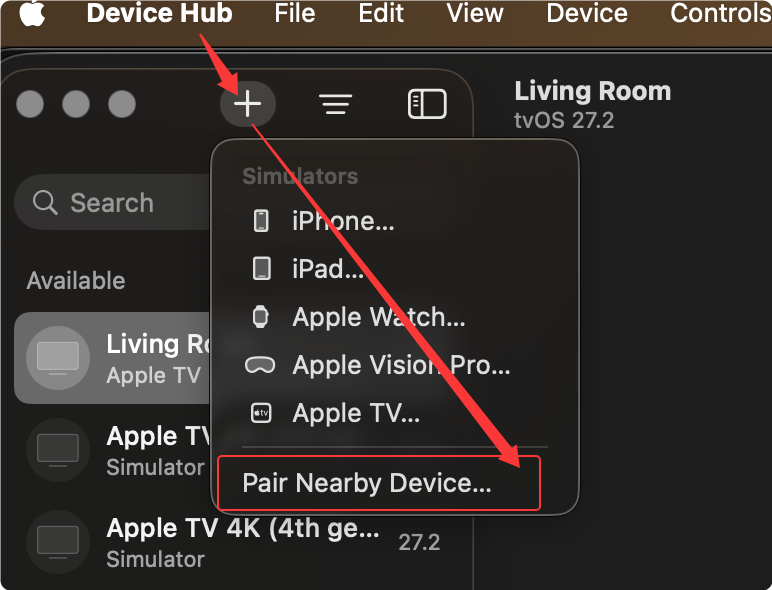

tvOS Browser
=============

***tvOS Browser*** is a web browser for Apple TV (tvOS). It supports the Siri Remote and gamepads (Switch Pro, PS5 DualSense, Xbox).

It uses private tvOS APIs (`WKWebView` is not public on tvOS), so it **cannot be published on the App Store** and there is no prebuilt installer. The only way to install it is to compile the source with your own Mac and Xcode and install it on your own Apple TV. This document walks through it step by step.

The code is provided as is, with no warranty, and you use it at your own risk. Please **do not** publish builds of this project to the App Store.

For implementation details of each feature, see [FEATURES.md](FEATURES.md).


Contents
-------------

1. [Prerequisites](#1-prerequisites)
2. [Step 1: Add your Apple Account to Xcode to get a Personal Team](#2-step-1-add-your-apple-account-to-xcode-to-get-a-personal-team)
3. [Step 2: Change the project's signing to your own Team](#3-step-2-change-the-projects-signing-to-your-own-team)
4. [Step 3: Pair an Apple TV on the same network with Device Hub](#4-step-3-pair-an-apple-tv-on-the-same-network-with-device-hub)
5. [Step 4: Build & Run to install the app on the Apple TV](#5-step-4-build--run-to-install-the-app-on-the-apple-tv)
6. [Controlling the Apple TV from your computer: Apple TV Remote](#6-controlling-the-apple-tv-from-your-computer-apple-tv-remote)
7. [How to use the browser](#7-how-to-use-the-browser)
8. [Troubleshooting](#8-troubleshooting)
9. [Installation notes for AI agents](#9-installation-notes-for-ai-agents)


1. Prerequisites
-------------

| What you need | Notes |
| --- | --- |
| A Mac | With **Xcode 27** or later (the project was verified with Xcode 27.2). |
| tvOS platform component | Xcode → Settings → **Components**; make sure **tvOS** is downloaded. Without it Xcode cannot recognize the Apple TV. |
| An Apple TV | Running **tvOS 27** or later. For older versions you need to lower the project's Deployment Target; see [Troubleshooting](#8-troubleshooting). |
| An Apple Account | A regular free Apple ID is enough. You do **not** need the US$99-per-year developer membership. |
| The same local network | The Mac and the Apple TV must be on the same Wi-Fi / router. The Apple TV 4K has no USB port, so the connection can only go over the network. |

Download the source:

```bash
git clone https://github.com/shishiv30/tvOSBrowser.git
```

Then open `_Project/Browser.xcodeproj` in Xcode. Note that the project is inside the `_Project` directory, not at the repository root.


2. Step 1: Add your Apple Account to Xcode to get a Personal Team
-------------

Xcode needs a **Team** to sign the app. With a free account there is no "apply" step: **as soon as you sign in to your Apple Account in Xcode, Apple automatically creates a personal team called "Your Name (Personal Team)" for you.**

1. Open Xcode and choose **Xcode → Settings…** from the menu bar (shortcut `⌘,`).
2. Select the **Apple Accounts** tab (called **Accounts** in older versions of Xcode).
3. Click **+** at the bottom left, choose **Apple Account**, and click Continue.
4. Enter your Apple ID and password, and complete two-factor authentication when prompted.
5. After signing in you will see a row **"Your Name (Personal Team)"** on the right, with the Role **User**. Seeing this row means the Team exists.

A few places where people get stuck:

- **The Apple ID must have two-factor authentication turned on**, otherwise you cannot sign in.
- If this Apple ID has never been used for development, the first sign-in may ask you to agree to the Apple Developer Agreement. Agree to it on the page that pops up; no payment is needed.
- If the list only shows a company / school team and no Personal Team, the account already belongs to a paid team, and you can simply use that team.

Limits of the free Personal Team (paid membership does not have them):

- Apps installed on a device **expire after 7 days**; after that they will not open and you have to Build & Run again. Your data is not lost.
- A single account can have at most 3 self-signed apps installed at the same time.
- At most 10 new Bundle Identifiers can be created every 7 days, so do not keep changing it once you have picked one.


3. Step 2: Change the project's signing to your own Team
-------------

The project in the repository contains the original author's Team and Bundle Identifier, and **signing will definitely fail if you do not change them**.

1. In Xcode's file list on the left (Project Navigator), click the blue **Browser** icon at the very top.
2. In the list that appears in the middle, select **Browser** under **TARGETS** (not the one under PROJECT).
3. Click the **Signing & Capabilities** tab at the top.
4. Check **Automatically manage signing**.
5. In the **Team** drop-down, choose your **"Your Name (Personal Team)"**.
6. Change the **Bundle Identifier** to a name that is unique worldwide, for example `com.yourname.tvbrowser`. It cannot duplicate anyone else's, so do not keep the `com.conjeezou.tvbrowser` from the repository.


After the change, this page should no longer show red errors. If you have not paired an Apple TV yet, you may see a message saying no devices are available (at least one registered device is needed to generate a provisioning profile). This is normal and will disappear by itself after the next step.


4. Step 3: Pair an Apple TV on the same network with Device Hub
-------------

The Apple TV 4K has no cable port, so Xcode connects to it over the local network. You have to "pair" once before connecting; the pairing information is saved, so you will not need to do this again.

**You need to be in front of the TV for this step**, because the pairing code is shown on the TV screen.

### 4.1 First, open the pairing screen on the Apple TV

Using the remote, go to this screen on the Apple TV:

**Settings → Remotes and Devices → Remote App and Devices**

**Stay on this screen and do not leave it.** The Apple TV only advertises itself while it is on this screen, and only then can Xcode find it. This is the step people miss most often: if the TV is not on this screen, nothing shows up on the Mac.

### 4.2 Open Device Hub on the Mac and pair

1. In the Xcode menu bar choose **Window → Devices** to open the **Device Hub** window.
   (In Xcode 26 and earlier this window is called **Devices and Simulators**, shortcut `⇧⌘2`; the Apple TV appears directly in the list on the left, and you select it and click **Pair**.)
2. In Device Hub, click the **+** button at the top of the sidebar and choose **Pair Nearby Device…** (the red arrow and box in the screenshot below).
3. Your Apple TV's name (for example "Living Room") appears in the list; select it.
4. A **verification code** appears on the TV screen.
5. Enter this code in the dialog that pops up on the Mac, and confirm.
6. Once pairing succeeds, the Apple TV shows up under the paired devices in Device Hub, with the status connected.



### 4.3 Turn on Developer Mode on the Apple TV

After pairing, a new switch appears on the Apple TV:

**Settings → Privacy & Security → Developer Mode**

Turn it on; the Apple TV will ask to restart, and after the restart you confirm once more. **Without Developer Mode, Xcode can see the device but cannot install apps on it.** This menu item only appears after the TV has been paired with Xcode; it cannot be found before that.

### 4.4 If the Apple TV cannot be found, check these

- Is the Apple TV still on the **Remote App and Devices** screen? (After the screensaver starts or the TV sleeps, you have to go back into it.)
- Are the Mac and Apple TV on the **same network and the same subnet**? Guest networks, routers with "AP isolation / client isolation" turned on, and different subnets of a mesh network can all stop them from seeing each other.
- Is the Mac running a VPN or a proxy app in "enhanced mode / TUN mode"? These often block local network discovery; turn them off and try again.
- In macOS **System Settings → Privacy & Security → Local Network**, is Xcode allowed?
- Has Xcode's tvOS component been downloaded (see [Prerequisites](#1-prerequisites))?
- If everything checks out and it still cannot be found: restart the Apple TV, quit and reopen Xcode, and try again.


5. Step 4: Build & Run to install the app on the Apple TV
-------------

1. Look at the toolbar in the middle at the top of the Xcode window; it has an area shaped like **Browser > some device**. The left half is the Scheme; confirm it is **Browser**.
2. Click the device name in the right half and choose your **real Apple TV** from the list that pops up (it is in the upper part of the list and shows your TV's name). Do not choose a simulator under "tvOS Simulators"; that only simulates on the Mac.
3. Click the **▶ Run** button at the top left (shortcut `⌘R`).
4. Xcode then does these things in order: compile → sign → transfer the app to the Apple TV over the network → install → launch. The first time you connect to a given device, Xcode also has to copy debug symbols from it first; progress is shown at the top of the window and it can take a few minutes.
5. When the browser opens on the TV by itself, it worked. From then on the app stays on the Apple TV home screen and can be opened without the Mac.

Things you may run into the first time:

- **A Keychain prompt** asking whether `codesign` may access a key: enter your Mac login password and click **Always Allow**.
- **The TV says the developer is not trusted**: on the Apple TV, go to **Settings → General**, find the device management / profile entry, trust your developer certificate, then Run again.
- To update after changing code: just click **▶ Run** again; it installs over the old copy.
- If the app will not open after 7 days: Run again in the same way.

`xcodebuild` on the command line only compiles by default and does not install. To install from the command line, see [Section 9](#9-installation-notes-for-ai-agents).


6. Controlling the Apple TV from your computer: Apple TV Remote
-------------

Picking up the remote over and over while debugging is a hassle, and picking letters one by one with the remote in a web input box is worse. **[Apple TV Remote](https://github.com/shishiv30/appletv-remote)** is a macOS app that lets you control the Apple TV on the same network directly with your Mac's keyboard and mouse.

What it can do:

- **Lives in the menu bar**: click the menu bar icon to pop up the remote panel whenever you need it.
- **Full remote**: arrow keys, select, Menu / Back, Home, Play / Pause, volume.
- **Keyboard input**: when a text field appears on the Apple TV, just type on the Mac. Especially useful for entering URLs and search terms in the browser.
- **App launcher**: lists the apps installed on the Apple TV and opens them directly.
- **`atv` command-line tool**: can be used in scripts and is also handy for AI agents.

Install and pair:

1. Download the DMG from the [repository's Releases page](https://github.com/shishiv30/appletv-remote/releases) and drag `AppleTVRemote.app` into Applications. macOS 13 or later is required. You can also build it from source following the repository README.
2. Open the app, select your Apple TV in the sidebar, and click **Connect**.
3. A 4-digit PIN is shown on the TV; enter it on the Mac. The credentials are saved and it reconnects automatically afterwards.

This pairing is separate from the Xcode pairing in Section 4; they do not affect each other, and you need to do each once.

Command-line examples (you need to install `atv` following the repository README):

```bash
atv list                 # List the Apple TVs on the local network
atv pair "Living Room"   # Pair (prompts for the PIN shown on the TV)
atv select "Living Room" # Set as the default device
atv u / d / l / r        # Up / Down / Left / Right
atv click                # Select
atv menu                 # Menu / Back
atv pp                   # Play / Pause (opens the Quick Menu in this browser)
atv apps                 # List installed apps and their Bundle IDs
atv launch <bundleID>    # Launch an app, for example the browser you just installed
```

The key presses it sends are the same as a real remote's, so the controls in the next section work with it too.


7. How to use the browser
-------------

The remote and gamepads use the same set of logical keys:

| Logical key | Siri Remote | Gamepad |
| --- | --- | --- |
| Move pointer | Arrow keys / touch surface | D-pad, left stick; hold a trigger (L2 / R2, ZL / ZR, LT / RT) to speed up |
| Back / forward in history | Quick Menu | L1 / L / LB goes back, R1 / R / RB goes forward |
| Confirm (click) | Select | A |
| Cancel (back) | Menu / Back | B |
| Menu (Quick Menu) | Play / Pause | X, Y, short-press − |
| Scroll page | Quickly press Up / Down twice | Right stick, or quickly press the D-pad twice |
| Game Mode toggle | — | Hold − (Create on PS5, View on Xbox) for 0.7 seconds |

- **Watching video**: open the Quick Menu and choose **Full Screen Video** (the first item); the video under the pointer, or the page's main video, fills the screen. Select itself only clicks. While fullscreen, Left / Right seeks back / forward 10 seconds, Select pauses / plays, and Cancel exits fullscreen.
- **Quick Menu**: Back, Forward, enter a URL or search, Refresh, Hide Top Bar, Ad Block toggle, Game Mode, More Options, Bookmarks.
- **Game Mode**: when on, the gamepad no longer controls the browser and is instead handed to the web page through the standard Gamepad API, for playing browser games. Hold the same button again to exit. **Gamepad Test** in the bookmarks lets you check that every gamepad button works.
- **New tabs**: links that would "open in a new window" navigate directly in the current page.

For the full description, see [FEATURES.md](FEATURES.md).


8. Troubleshooting
-------------

**Error "Signing for "Browser" requires a development team"**
No Team is selected. Go back to [Section 3](#3-step-2-change-the-projects-signing-to-your-own-team).

**Error "Failed to register bundle identifier" / "The app identifier cannot be registered"**
The Bundle Identifier duplicates someone else's. Pick a more distinctive one.

**Error "No profiles for '…' were found", or a message saying there are no devices**
A provisioning profile needs at least one registered device. Finish the pairing in [Section 4](#4-step-3-pair-an-apple-tv-on-the-same-network-with-device-hub) first, then go back to the Signing & Capabilities page and the error will disappear by itself; if it does not, click **Try Again**.

**The Apple TV is greyed out in the device list, or a message says the OS version is not supported**
The project requires tvOS 27 at minimum. If your Apple TV runs an older version: under TARGETS → Browser → **General** → **Minimum Deployments**, lower the tvOS version to your system version. Older systems have not been verified, and there is no guarantee that it compiles or runs correctly.

**Xcode says it needs to download tvOS support / the device shows "Preparing…" for a long time**
The first connection has to prepare debug symbols; wait for it to finish. If it says a platform is missing, download tvOS in Xcode → Settings → Components.

**The installed app stops opening after a few days**
Free-account signing expires after 7 days. Connect to the Mac and Run again.

**Run says the device cannot be found, but it was paired before**
The Apple TV may be asleep, or its IP may have changed. Wake the TV and make sure it is on the same network as the Mac; if that does not help, unpair it in Device Hub and pair it again.


9. Installation notes for AI agents
-------------

This section is written for AI agents helping a user install the app. The sections above are detailed steps for humans; this one is a list of facts and commands that can be run directly.

### Project facts

| Item | Value |
| --- | --- |
| Project file | `_Project/Browser.xcodeproj` (no workspace, no CocoaPods / SPM dependencies) |
| Scheme | `Browser` |
| Target | `Browser` |
| Language | Objective-C, plus two bundled resources: `BrowserPageAgent.js` and `GamepadTest.html` |
| Platform | tvOS, Deployment Target 27.0 (set at Target level) |
| Bundle Identifier | `com.conjeezou.tvbrowser` in the repository; **must be replaced with the user's own** |
| `DEVELOPMENT_TEAM` | The original author's Team ID in the repository; **must be replaced with the user's own** |
| Signing | Automatic (Automatically manage signing) |

There is no `npm` and no test target. The fastest way to verify that it compiles is to build against the simulator SDK:

```bash
xcodebuild -project _Project/Browser.xcodeproj -scheme Browser -sdk appletvsimulator -configuration Debug CODE_SIGNING_ALLOWED=NO build
```

### Steps only the user can do

The agent cannot do the following. When one comes up, stop and point the user to the matching section:

1. **Sign in to the Apple Account in Xcode** (Section 2). It involves a password and two-factor authentication, which the agent should not handle.
2. **Read the pairing code in front of the TV and enter it** (Section 4.2). The code is only shown on the TV screen.
3. **Turn on Developer Mode on the Apple TV and restart** (Section 4.3).
4. **Go to the "Remote App and Devices" screen on the Apple TV** (Section 4.1). If the user has already paired with the `atv` tool from Apple TV Remote, the agent can do this step with `atv` arrow-key commands.

### Check prerequisites

```bash
xcodebuild -version
```

```bash
xcodebuild -showsdks | grep -i tvos
```

```bash
xcrun devicectl list devices
```

In the output of the last command, the `Reality` column is `physical` for a real device and `simulated` for a simulator. A real device can only be installed to when its `State` is `connected` or `available (paired)`. If no real device is listed, it has not been paired yet, or the TV is not on the same network.

After the user has finished Section 3, their Team ID can be read from the project file:

```bash
grep -n "DEVELOPMENT_TEAM\|PRODUCT_BUNDLE_IDENTIFIER" _Project/Browser.xcodeproj/project.pbxproj
```

The project has two sets of settings, Project-level and Target-level; the Target-level ones (the two configuration blocks that contain `PRODUCT_BUNDLE_IDENTIFIER`) are the ones that take effect.

### Build from the command line and install on a real device

Replace `<DEVICE_NAME>` with the Name from `devicectl list devices`, and `<TEAMID>` and `<BUNDLE_ID>` with the user's values:

```bash
xcodebuild -project _Project/Browser.xcodeproj -scheme Browser -configuration Debug -destination 'platform=tvOS,name=<DEVICE_NAME>' -derivedDataPath build -allowProvisioningUpdates DEVELOPMENT_TEAM=<TEAMID> PRODUCT_BUNDLE_IDENTIFIER=<BUNDLE_ID> build
```

```bash
xcrun devicectl device install app --device '<DEVICE_NAME>' build/Build/Products/Debug-appletvos/Browser.app
```

```bash
xcrun devicectl device process launch --device '<DEVICE_NAME>' <BUNDLE_ID>
```

Notes:

- `-allowProvisioningUpdates` lets `xcodebuild` create / update the provisioning profile automatically. It requires the user to have signed in to an account in Xcode already.
- If the user has already set the Team and Bundle Identifier on the Signing & Capabilities page in Xcode, `DEVELOPMENT_TEAM=…` and `PRODUCT_BUNDLE_IDENTIFIER=…` can be omitted from the command.
- The first time you build for a given device, the first signing may pop up a Keychain authorization dialog, and the user has to click Allow on the Mac.
- Clicking Run in the Xcode UI is equivalent to the three commands above, and additionally attaches the debugger and shows `NSLog` output. When troubleshooting, prefer having the user use Run in Xcode.

### Diagnosing failures

| Symptom | Cause | Section |
| --- | --- | --- |
| `requires a development team` | No Team set | Section 3 |
| `No Accounts` / `No account for team` | Not signed in to an account in Xcode | Section 2 |
| `Failed to register bundle identifier` | Duplicate Bundle Identifier | Section 3 |
| `Unable to find a destination matching` | Wrong device name, not paired, or tvOS component not installed | Sections 1, 4 |
| `devicectl` reports the device has Developer Mode disabled | Developer Mode not turned on | Section 4.3 |
| No real device in `devicectl list devices` | Not paired, or not on the same network | Section 4 |
| Installed fine but crashes on launch after 7 days | Free-account signing expired | Reinstall |

### When changing code

- This project uses the non-public `WKWebView` on tvOS through runtime reflection (`NSClassFromString` + `objc_msgSend`). Do not change it to a direct `#import <WebKit/WebKit.h>`; the tvOS SDK has no such header.
- When adding files that must be bundled with the app (`.js`, `.html`, images), also add them to the Resources build phase in `project.pbxproj`, otherwise they cannot be found in the Bundle at runtime.
- Behavior notes and known unverified items are recorded in [FEATURES.md](FEATURES.md); update it after changing behavior.
- All code, comments, documentation and UI text in this project must be written in English.
